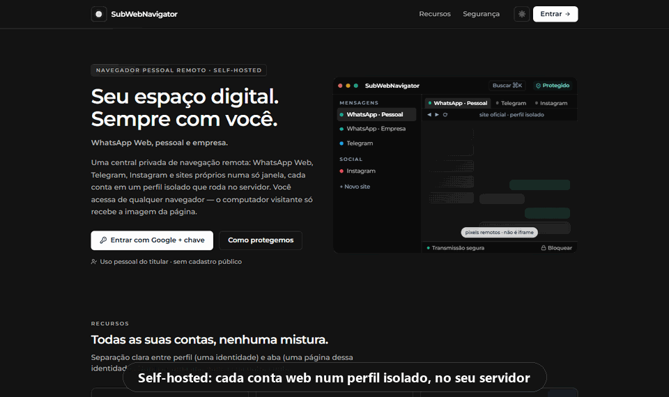
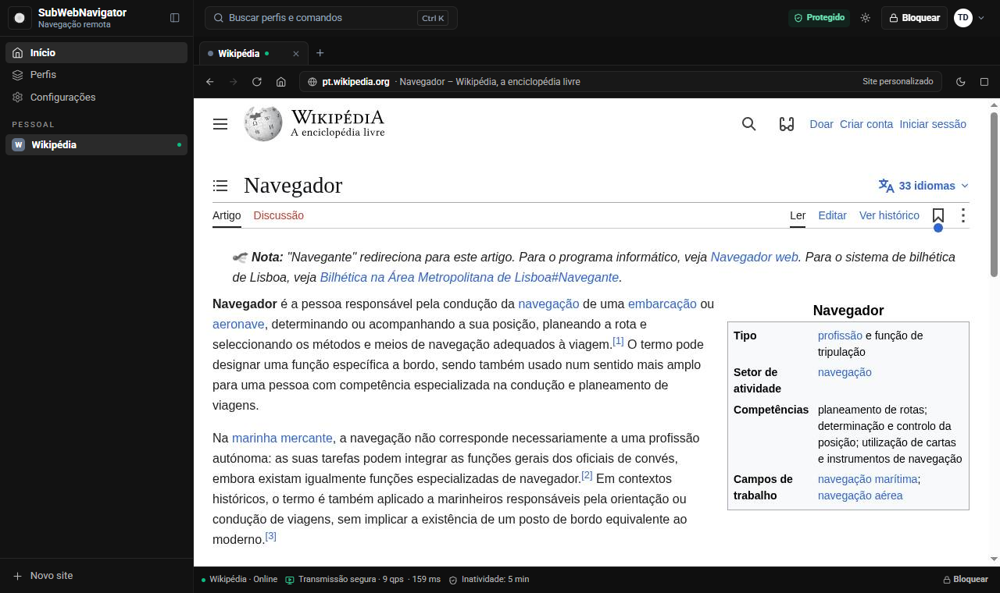
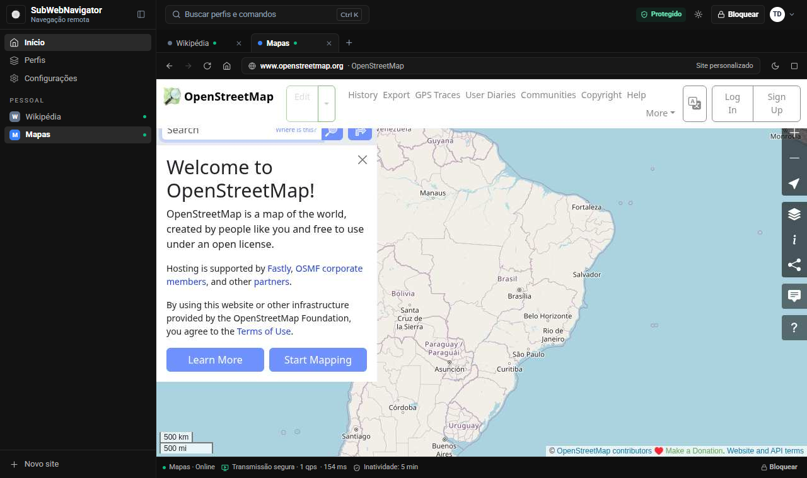
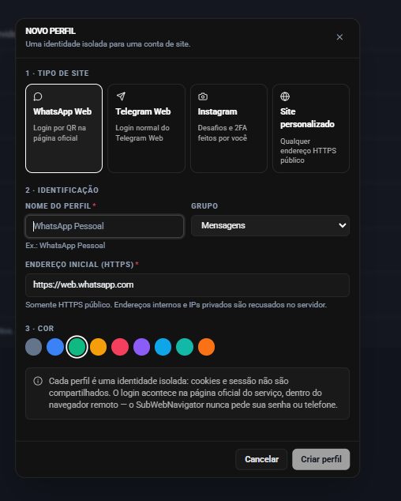
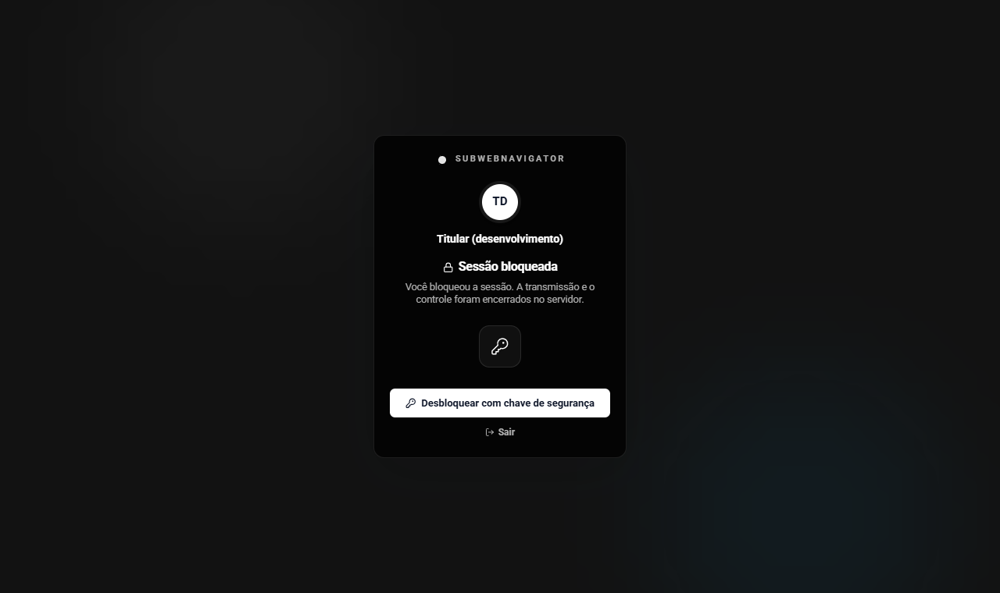
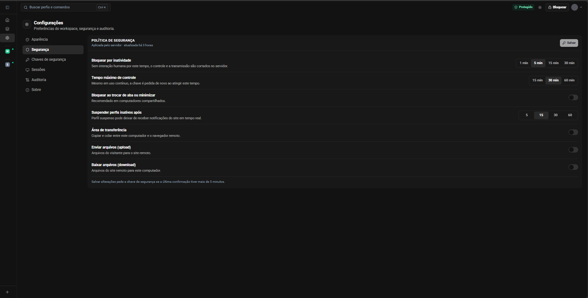
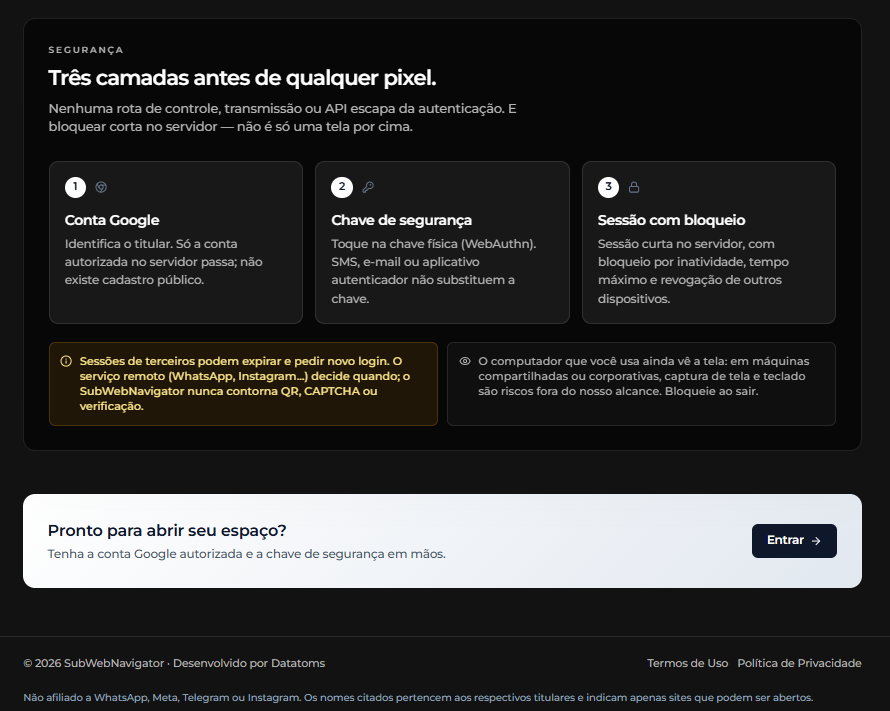
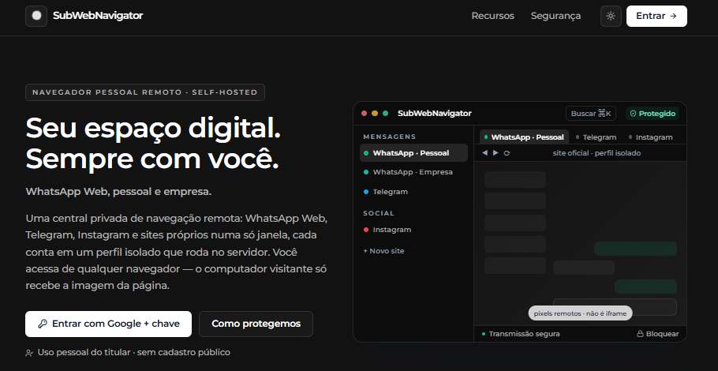
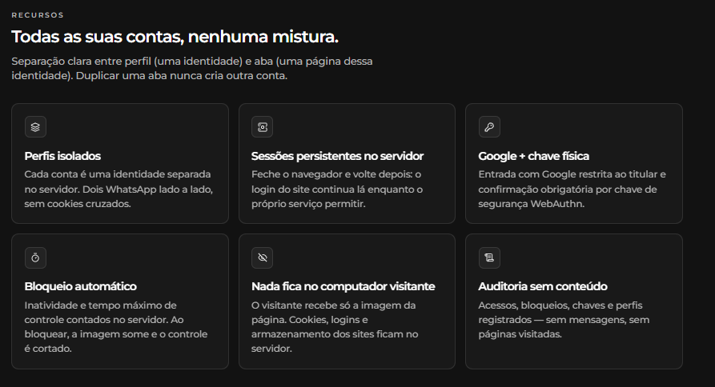
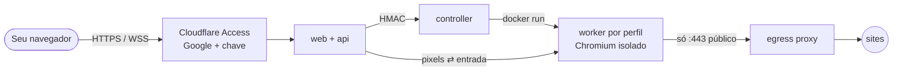

<div align="center">

# SubWebNavigator

**Seu navegador pessoal, rodando no seu servidor.**
Várias contas web ao mesmo tempo (WhatsApp Web, Telegram, Instagram ou qualquer site HTTPS), cada uma num perfil isolado. Entrada com Google + chave de segurança física.

[](LICENSE)




*Self-hosted remote browser with isolated per-account profiles, Google sign-in and mandatory FIDO2 security key. Docs in Portuguese.*

</div>

---

## Por que existe
Abrir o WhatsApp pessoal, o da empresa e mais algumas contas num computador que não é seu deixa cookies, sessões e rastros para trás. No SubWebNavigator, **os sites rodam num Chromium no seu servidor**, um container por conta, e o computador que você está usando recebe só a imagem da página. Feche a aba e nada fica para trás. Volte depois e as sessões continuam lá.

## Recursos
- 🧩 **Perfis isolados.** Cada conta tem seu próprio container e volume. Dois WhatsApp lado a lado, sem cookies cruzados.
- 🖥️ **Só pixels no visitante.** A página chega num `<canvas>`, sem iframe, cookies ou armazenamento do site.
- 🔑 **Google + chave física obrigatória.** WebAuthn com chave FIDO2 (YubiKey, Titan…). Passkeys sincronizadas na nuvem são recusadas.
- 🔒 **Bloqueio de verdade.** Inatividade e tempo máximo contados no servidor. Ao bloquear, a transmissão e o controle são cortados lá, não é uma tela por cima.
- 💾 **Sessões persistentes.** Bloqueie, saia e volte: o login dos sites continua no servidor.
- 🛡️ **Worker endurecido.** Sandbox do Chromium ligado, seccomp, rootfs read-only, `cap_drop: ALL`, rede sem saída direta. Egress só para IP público na porta 443.
- 📜 **Auditoria sem conteúdo.** Acessos, bloqueios, chaves e perfis registrados, sem mensagens nem páginas visitadas.
- ⚡ **Transmissão com controle de fluxo.** Confirmação por quadro e qualidade adaptativa: sem atraso acumulado em links lentos.

## Telas
| Workspace | Dois perfis isolados |
|---|---|
|  |  |

| Novo perfil | Sessão bloqueada |
|---|---|
|  |  |

| Política de segurança | Camadas de acesso |
|---|---|
|  |  |

<details>
<summary>Página inicial</summary>




</details>

## Início rápido (desenvolvimento)
**Você precisa de:** Node 22.12+, Docker 24+ (Docker Desktop serve), cerca de 4 GB de RAM livres e uma chave de segurança FIDO2. Sem chave, use o autenticador virtual do Chrome: DevTools → ⋮ → More tools → **WebAuthn**.

```bash
git clone https://github.com/brenosandro/SubWebNavigator.git
cd SubWebNavigator
npm install
npm run setup          # gera o .env com segredos aleatórios e login de desenvolvimento
npm run docker:up      # Postgres + egress proxy + relay + rede interna dos workers
npm run migrate:dev
npm run worker:image   # imagem do Chromium (a primeira vez leva alguns minutos)
npm run dev            # API :3460 · controller :3470 · web http://localhost:5180
```

Abra **http://localhost:5180**, clique em **Entrar em modo desenvolvimento**, cadastre a chave e crie seu primeiro perfil. O login de desenvolvimento só existe fora de produção: a validação de configuração o bloqueia em `NODE_ENV=production`.

Detalhes, Google OAuth local e testes: [docs/development.md](docs/development.md).

## Configuração mínima
| Uso | Servidor | Observação |
|---|---|---|
| Teste local | 2 vCPU · 4 GB RAM · 5 GB de disco | Docker Desktop no Windows/macOS ou Linux |
| Pessoal (1–2 perfis ativos) | Linux x86-64 · 2 vCPU · 4 GB RAM | cada perfil ativo usa até 1,5 GB (`WORKER_MEMORY_LIMIT_MB`) |
| 3 perfis ativos (padrão) | Linux x86-64 · 4 vCPU · 8 GB RAM | `MAX_SIMULTANEOUS_WORKERS=3` |
| Rede | upload ≥ 8 Mbit/s | a fluidez depende do **upload do servidor** |

Os números de memória vêm dos limites padrão do worker. Não são resultado de teste de carga.

Em produção você também precisa de um domínio na Cloudflare (Zero Trust gratuito), um cliente OAuth do Google e, de preferência, **duas** chaves de segurança (a segunda é reserva).

## Como funciona


A arquitetura completa, com sequências de login e transmissão, ciclo de vida dos perfis e modelo de dados, está em **[docs/architecture.md](docs/architecture.md)**.

## Estrutura
```
apps/web          React 18 · Vite · Tailwind
apps/api          Fastify 5 · Prisma · WebAuthn · gateway WSS
apps/controller   único com acesso ao Docker
apps/worker       Xvfb + Chromium (CDP por pipe)
apps/edge         egress proxy + relay
packages/protocol protocolo compartilhado (zod)
infra/            Dockerfiles, nginx, seccomp, firewall
docs/             arquitetura, segurança, deploy, roadmap, ADRs
```

## Documentação
| Documento | Conteúdo |
|---|---|
| [Arquitetura](docs/architecture.md) | componentes, redes, fluxos, dados e API, com diagramas |
| [Segurança](docs/security.md) | modelo de ameaças, isolamento, matriz de testes, resposta a incidentes |
| [Deploy](docs/deploy.md) | produção com Docker Compose + Cloudflare Tunnel/Access |
| [Desenvolvimento](docs/development.md) | ambiente local, scripts, testes e convenções |
| [Roadmap](docs/roadmap.md) | o que está pronto, o que foi verificado e o que falta |
| [ADRs](docs/adr/) | decisões de stack, autenticação, runtime e streaming |

## Limitações
- **É uma transmissão.** O site roda no servidor e a fluidez depende do upload. Com cerca de 8 Mbit/s, ficam cerca de 8 quadros/s e 200 ms de atraso: dá para ler e responder mensagens, mas não é como um navegador local. Vídeo (VP8/H.264) no lugar de JPEG está no [roadmap](docs/roadmap.md).
- **Protótipo.** Hardening de produção e pentest ainda não foram feitos. Leia [security.md](docs/security.md) antes de usar com contas importantes.
- Áudio, upload/download e área de transferência estão desligados.
- O sigilo em repouso dos perfis depende de **volume cifrado no host** (ex.: LUKS).
- Sites de terceiros podem expirar sessões, pedir QR ou CAPTCHA, ou bloquear o acesso. O projeto nunca tenta contornar isso.

## Contribuindo
Issues e pull requests são bem-vindos. Veja [CONTRIBUTING.md](CONTRIBUTING.md). Para vulnerabilidades, use o canal privado descrito em [SECURITY.md](SECURITY.md), não issues públicas.

## Licença
[MIT](LICENSE) © Datatoms

> Não afiliado a WhatsApp, Meta, Telegram, Instagram, Wikipédia ou OpenStreetMap. Os nomes citados pertencem aos respectivos titulares e indicam apenas sites que podem ser abertos. Respeite os termos de uso de cada serviço.
