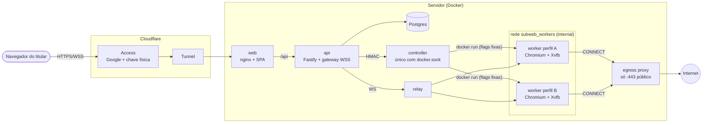
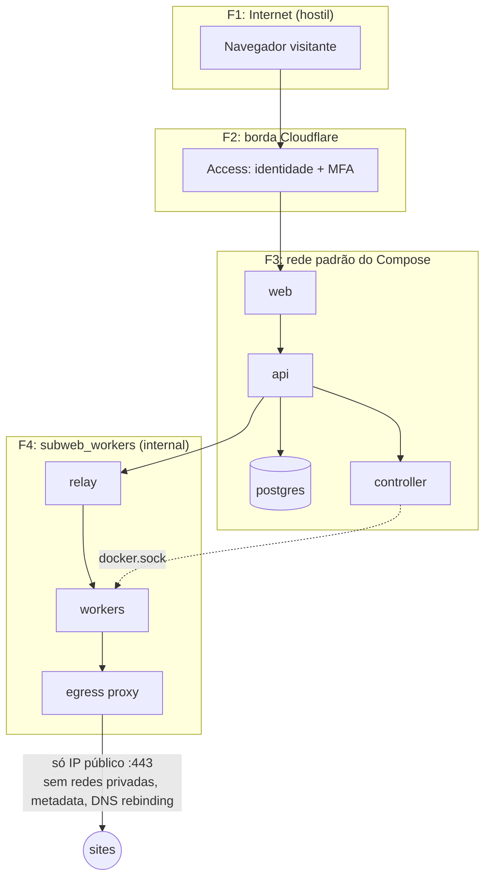
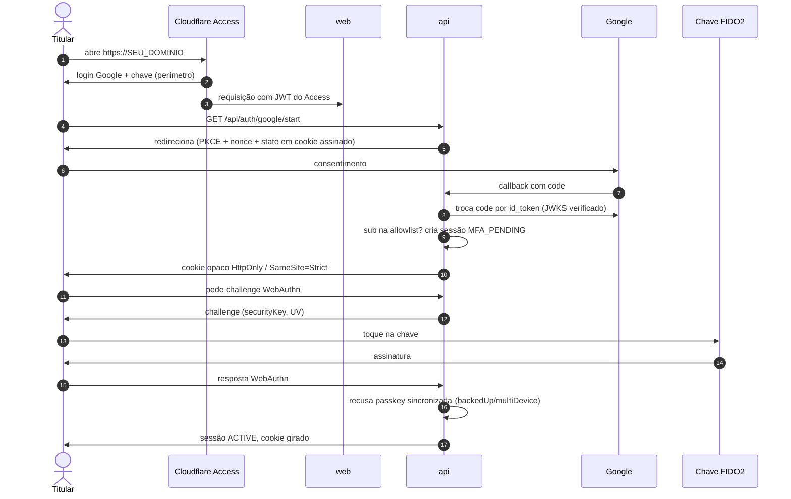
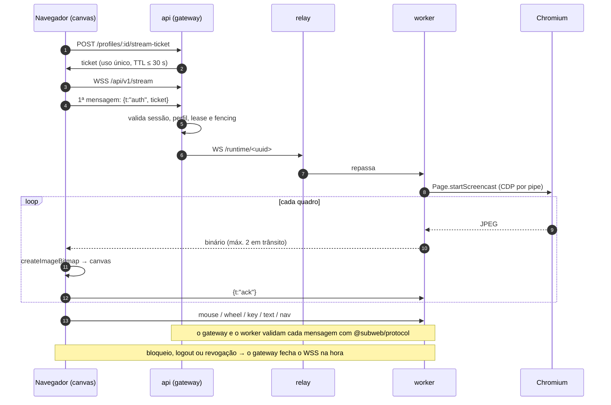
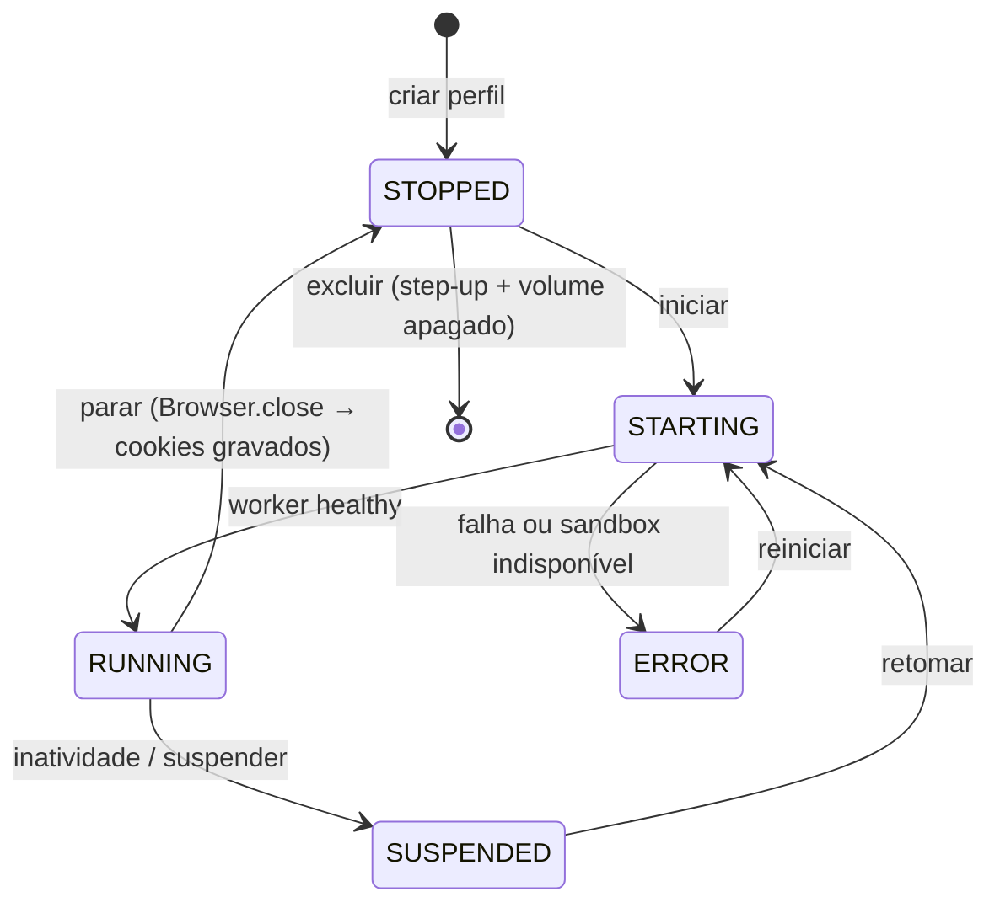
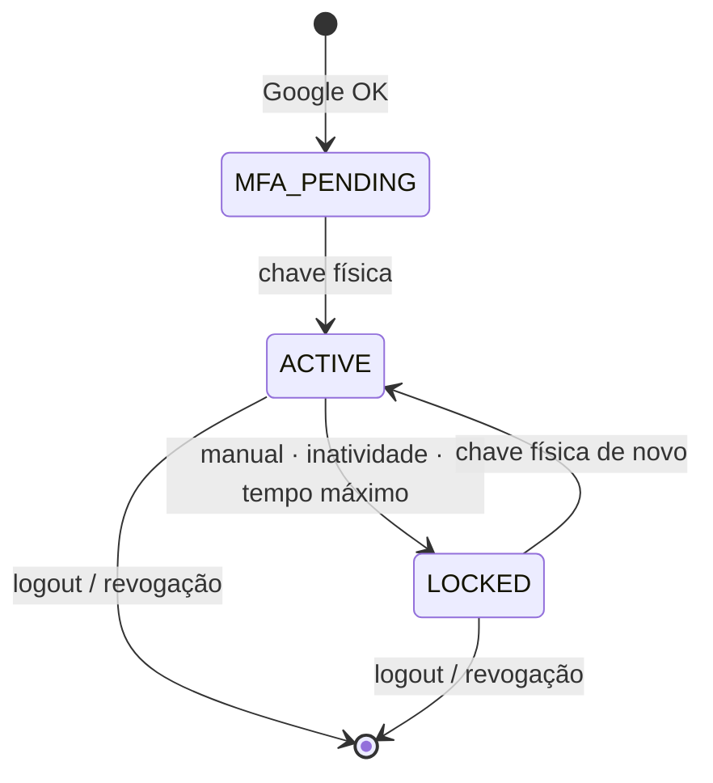
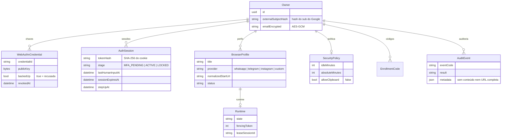

# Arquitetura

O SubWebNavigator é um monorepo TypeScript (npm workspaces) com cinco aplicações e um pacote compartilhado. Os diagramas abaixo são Mermaid e o GitHub os renderiza direto.

- [Estrutura do monorepo](#estrutura-do-monorepo)
- [Visão geral](#visão-geral)
- [Redes e fronteiras de confiança](#redes-e-fronteiras-de-confiança)
- [Login: Access, Google e chave física](#login-access-google-e-chave-física)
- [Transmissão e controle de fluxo](#transmissão-e-controle-de-fluxo)
- [Ciclo de vida do perfil](#ciclo-de-vida-do-perfil)
- [Estados da sessão](#estados-da-sessão)
- [Modelo de dados](#modelo-de-dados)
- [API HTTP](#api-http)

## Estrutura do monorepo

```
.
├── apps/
│   ├── web/          React 18 · Vite · Tailwind: landing, login, workspace (<canvas>), configurações
│   ├── api/          Fastify 5 · Prisma: autenticação, sessões, perfis, auditoria e gateway WSS
│   ├── controller/   único componente com acesso ao Docker: cria, suspende e para workers
│   ├── worker/       agente dentro do container de cada perfil: Xvfb + Chromium (CDP por pipe)
│   └── edge/         egress proxy (única saída dos workers) e relay (única entrada)
├── packages/
│   └── protocol/     @subweb/protocol: mensagens navegador ⇄ gateway ⇄ worker, validadas com zod
├── infra/
│   ├── docker/       Dockerfiles de cada serviço, nginx com CSP estrita
│   ├── worker/       perfil seccomp do Chromium (derivado do padrão do Docker)
│   └── firewall/     regra nftables que isola a rede dos workers do host
├── docs/             arquitetura, segurança, deploy, desenvolvimento, roadmap e ADRs
├── docker-compose.yml        dependências do ambiente local
└── docker-compose.prod.yml   stack completa de produção
```

| Pacote | Depende de | Quem fala com ele |
|---|---|---|
| `@subweb/web` | `@subweb/protocol` (só tipos) | navegador do titular |
| `@subweb/api` | `@subweb/protocol`, Postgres | web (HTTP + WSS), controller (HMAC), relay (WS) |
| `@subweb/controller` | Docker CLI | só a API |
| `@subweb/worker` | `@subweb/protocol` | só o relay |
| `@subweb/edge` | — | relay: API → workers · proxy: workers → internet |
| `@subweb/protocol` | zod | importado pela API, pelo worker e pela web |

O protocolo fica num pacote só para que gateway e worker validem **exatamente o mesmo esquema**: a API valida antes de repassar e o worker valida de novo (defesa em profundidade).

## Visão geral



- Nenhuma porta é publicada no host: a única entrada é o túnel.
- A rede dos workers é `internal`. Sem rota para fora, eles só falam com o relay (entrada) e o egress proxy (saída).
- O navegador do titular recebe **apenas pixels** num `<canvas>`. Cookies, armazenamento e sessões dos sites ficam no volume do perfil, no servidor.

## Redes e fronteiras de confiança



| Fronteira | Controle |
|---|---|
| Visitante → borda | Cloudflare Access (Google + chave de segurança) |
| Borda → origin | Tunnel; a API valida o JWT do Access (`ENFORCE_ACCESS_JWT`) |
| API → controller | HMAC sobre método, caminho, corpo e timestamp; janela de 30 s com anti-replay |
| API → worker | ticket de uso único + control lease com fencing token |
| Worker → internet | egress proxy: resolve o DNS e só conecta em IP público na porta 443 |
| Worker → host | sandbox do Chromium, seccomp, `cap_drop: ALL`, rootfs read-only, regra `nft` no host |

Detalhes, ameaças e testes: [security.md](security.md).

## Login: Access, Google e chave física



A primeira chave só é cadastrada com um **código de uso único gerado no servidor** (`enrollment-code`). Quem não tem acesso ao host não consegue cadastrar a chave inicial, mesmo com a conta Google do titular.

## Transmissão e controle de fluxo



**Por que `ack`?** Sem ele, o worker produz quadros mais rápido do que o caminho (gateway → nginx → túnel → upload) consegue entregar. Os quadros se acumulam nos buffers e a tela mostra o passado com segundos de atraso. Com no máximo 2 quadros em trânsito, o excedente é descartado e substituído pelo mais recente. A qualidade JPEG se ajusta à ida e volta medida (`stats` a cada 2 s).

## Ciclo de vida do perfil



Cada perfil tem um volume `swn-profile-<uuid>` e, quando ativo, um container `swn-worker-<uuid>`. Os dois são criados pelo controller **fora** do Compose.

## Estados da sessão



O relógio que conta inatividade e tempo máximo é o do **servidor**. Só entrada humana (`/auth/activity`) renova a inatividade; heartbeat não conta. Ações sensíveis exigem a chave de novo (step-up ≤ 5 min).

## Modelo de dados



O banco guarda só o hash do cookie, o hash do `sub` do Google e o e-mail cifrado. Nunca guarda conteúdo de páginas nem mensagens.

## API HTTP

| Método | Rota | Uso |
|---|---|---|
| GET | `/api/auth/config` · `/api/auth/session` | configuração pública e estado da sessão |
| GET | `/api/auth/google/start` · `/callback` | login Google (OIDC + PKCE) |
| POST | `/api/auth/webauthn/*` | cadastro, login, desbloqueio e step-up com a chave |
| POST | `/api/auth/activity` · `/lock` · `/logout` | atividade humana, bloqueio manual, saída |
| GET/POST/PATCH/DELETE | `/api/v1/profiles[/:id]` | CRUD de perfis (excluir exige step-up) |
| POST | `/api/v1/profiles/:id/{start,suspend,stop,touch}` | ciclo de vida do runtime |
| GET | `/api/v1/profiles/:id/stats` | CPU e memória do worker (só números) |
| POST | `/api/v1/profiles/:id/stream-ticket` | ticket de uso único para o WSS |
| GET | `/api/v1/stream` (WebSocket) | transmissão e entrada |
| GET/PATCH | `/api/v1/security-policy` | inatividade, tempo máximo, suspensão |
| GET/POST | `/api/v1/viewer-sessions[...]` | dispositivos conectados e revogação |
| GET/PATCH/DELETE | `/api/v1/security-keys[/:id]` | chaves de segurança |
| GET | `/api/v1/audit` | eventos de auditoria |

Toda rota que muda estado exige o cabeçalho anti-CSRF e `Origin` igual a `APP_ORIGIN`.

Decisões registradas: [ADR-001: stack e autenticação](adr/ADR-001-stack-e-autenticacao.md) · [ADR-002: runtime e streaming](adr/ADR-002-runtime-e-streaming.md).
